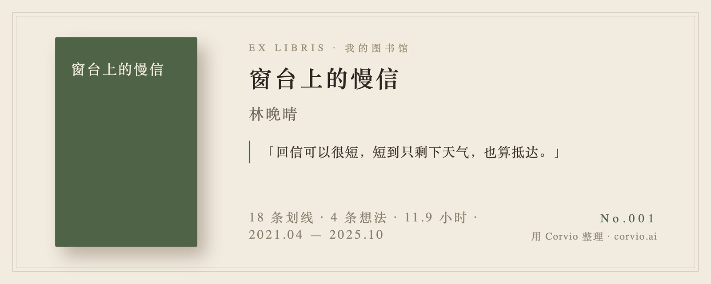
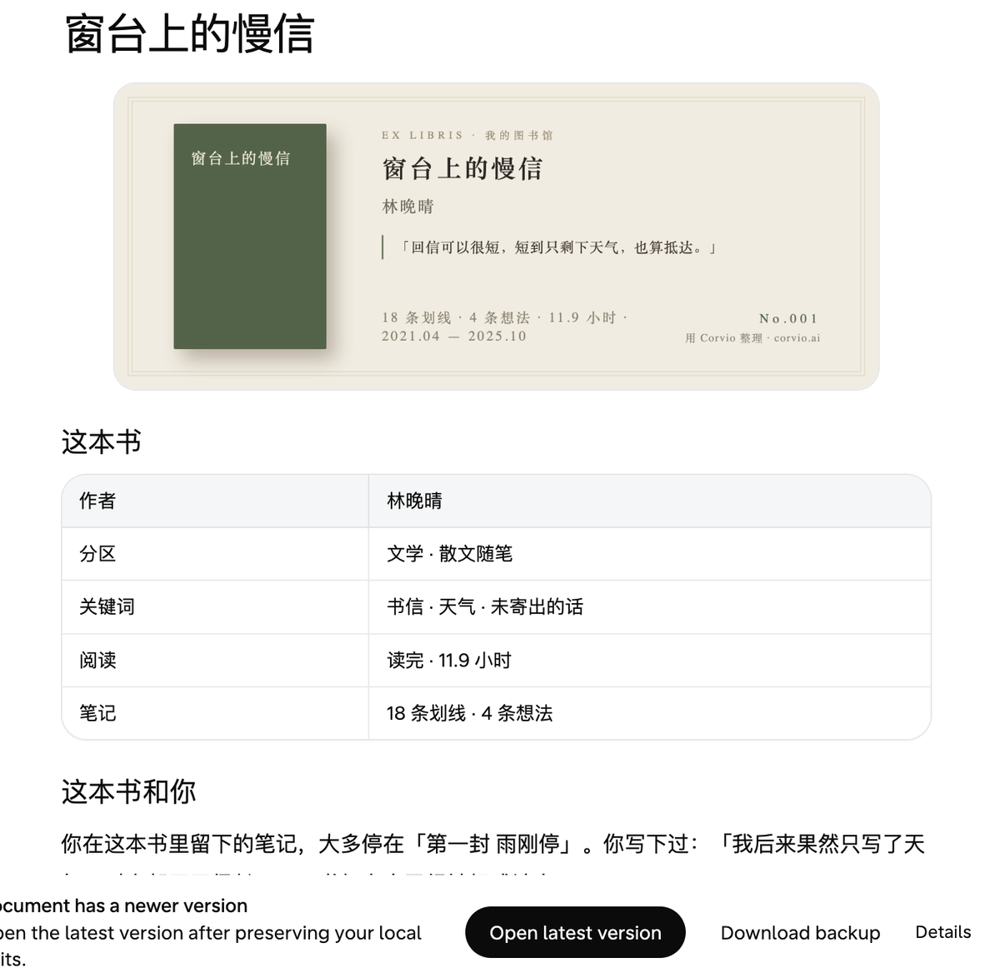
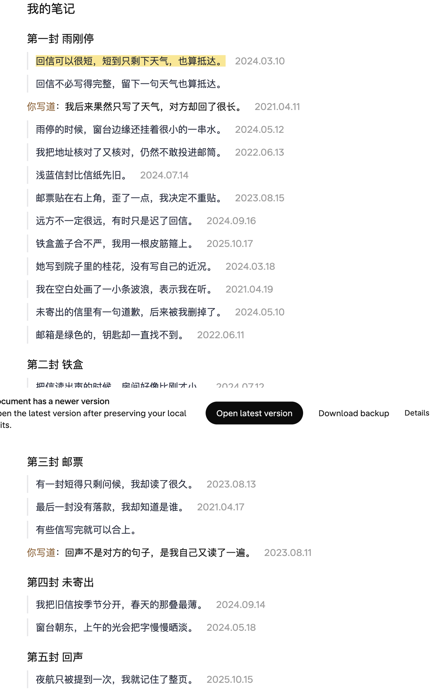
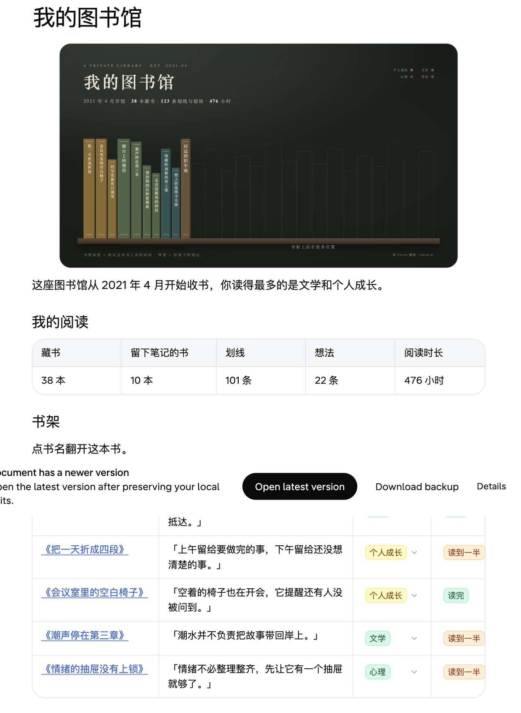

# 把微信读书，变成你的私人图书馆

你在微信读书上读了很多书，划了很多线，也写过不少想法。可它们散落在一本本书里：想回头翻翻，得一本本点进去找；读过哪些书、记住了什么，很难一眼看全。

这个工具把它们收拢成一座**属于你的图书馆**：

- **一面书墙**：你留过笔记的书排在一个书架上，书脊越高，读得越久。读过什么，一眼就能看到。
- **每本书一页**：开头是一张藏书票，印着你在这本书里最舍不得的那句话。往下是 AI 帮你写的一小段回顾，再往下是你所有的划线和想法，按章节排好，翻起来像自己的读书笔记本。

- **随时翻，随时加**：以后在微信读书里读了新书、划了新线，说一句「同步一下」，新笔记就会自动放进对应的书里。

## 它还能让 AI 读懂你读过的书

这座图书馆建在 [Corvio](https://corvio.ai) 上，一个能让 AI 读取你资料的笔记空间。建好之后，你在聊天时可以直接问 AI：

- 「我在哪本书里读到过关于『选择』的话？」
- 「根据我读过的书，下一本我该读什么？」
- 「采访一下我读的《某本书》，把重点记到这本书的页面上。」

AI 会去翻你的图书馆再回答，用的是你自己划过的句子，而不是网上的泛泛之谈。慢慢地，这里就成了你自己的读书知识库。

## 怎么用

你需要一个能帮你在电脑上执行操作的 AI 助手，比如 Claude Code、Codex。把下面这句话发给它：

> 帮我安装这个 skill：https://github.com/yehan-xiao/weread-library ，然后用它把我的微信读书做成一座图书馆。

接下来它会带着你做三件小事，每件都只要点一点：

1. **登录 Corvio**：浏览器会自动打开。没有账号的话，用邮箱注册一个就行。
2. **复制微信读书的 Key**：用微信扫码，点一下复制。这个 Key 只保存在你自己的电脑上，不会发给 AI，也不会上传到任何地方。
3. **给图书馆起个名字**：不想起就叫「我的图书馆」。

然后它会先把你笔记最多的 5 本书放上书架，几分钟就能看到。满意的话，再说「把剩下的书也整理进来」，它会分批整理全部。

## 常见问题

**我的笔记安全吗？** 你的数据只在你自己的电脑和你自己的 Corvio 空间里，图书馆默认只有你能看到。微信读书里设为私密的书，默认不会放进来。

**AI 写的那段回顾会乱编吗？** 不会。每段回顾写完都会用脚本核对一遍：引用的句子必须是你真的划过的，数字和日期必须能在你的阅读记录里查到，核对不通过就不会写进去。

**我在页面上写的东西会被覆盖吗？** 不会。同步只会把新笔记插进去，你自己在书页上加的内容会保留。在微信读书里删掉的划线，不会自动从页面上删掉。

**要花钱吗？** 这个工具本身免费。Corvio 的套餐以它的官网为准，你的 AI 助手按它自己的方式计费。

## 给开发者

| 文件 | 作用 |
| --- | --- |
| `SKILL.md` | 给 AI 看的完整流程 |
| `prompts/curation.md` | AI 写「最舍不得的一句」和回顾时遵守的规则 |
| `scripts/fetch.py` | 从微信读书官方接口拉数据，支持断点续跑和增量刷新 |
| `scripts/library.py` | 选书、生成阅读摘要、核对 AI 写的内容、计算全馆统计 |
| `scripts/render.py` | 生成书墙封面和藏书票 |
| `scripts/pages.py` | 生成页面内容 |
| `scripts/publish.py` | 用 Corvio 命令行工具写入：首次搭建、追加、同步都是这一条命令 |
| `scripts/put.py` | 只连了 Corvio MCP 时，把本地文件直接传给 Corvio |
| `sample/` | 一份虚构的样例数据，没有 Key 也能试跑 |

已知限制：只连了 Corvio MCP、没装命令行工具时写入较慢，10 本书大约 15 分钟。上传的图片会出现在 Corvio 工作区的文件列表里。
